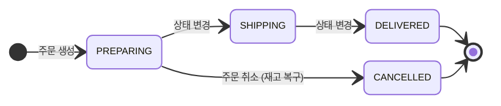

<div align="center">

# 🛒 Starter

**이커머스 백오피스 API 서버**

관리자가 고객 · 상품 · 주문 데이터를 한 곳에서 관리하는 백오피스 서비스입니다.

`2026.10.27 ~ 2026.11.03`

</div>

<br>

## 📌 목차

1. [팀원 소개](#-팀원-소개)
2. [기술 스택](#-기술-스택)
3. [주요 기능](#-주요-기능)
4. [트러블슈팅](./docs/troubleshooting/TROUBLESHOOTING.md)
5. [API 명세](./docs/API_SPEC.md)
6. [테이블 명세](./docs/TABLE_SPEC.md)
7. [협업 컨벤션](./docs/CONVENTION.md)
8. [실행 방법](#-실행-방법)


## 👥 팀원 소개

<!--
  - 이름 옆에 (Leader) / (Sub-Leader) 표기
  - GITHUB_ID 를 각자 깃허브 아이디로 바꾸면 프로필 사진이 자동으로 들어갑니다 (https://github.com/아이디.png)
  - 팀원을 추가하려면 <th>, <td> 를 한 칸씩 복사해서 4줄 모두에 붙여넣으면 됩니다
-->

<table>
  <tr>
    <th align="center" width="180">정재원</th>
    <th align="center" width="180">전영주</th>
    <th align="center" width="180">김다은</th>
  </tr>
  <tr>
    <td align="center"></td>
    <td align="center"></td>
    <td align="center"></td>
  </tr>
  <tr>
    <td align="center"><a href="https://github.com/ApprendistaKR">@ApprendistaKR</a></td>
    <td align="center"><a href="https://github.com/youngju0zoo">@youngju0zoo</a></td>
    <td align="center"><a href="https://github.com/euneuneun">@euneuneun</a></td>
  </tr>
  <tr>
    <td align="center">백엔드<br/>관리자 · 인증</td>
    <td align="center">백엔드<br/>고객 · 상품</td>
    <td align="center">백엔드<br/>주문</td>
  </tr>
</table>

<br>

## 🛠 기술 스택

| 분류 | 기술 |
| :---: | --- |
| **Language** |  |
| **Framework** |   |
| **Database** |  |
| **Build** |  |
| **Library** |   |
| **Auth** |  |
| **Tools** |    |

<!-- Notion, Slack, Postman 등 실제로 쓴 협업 도구가 있으면 Tools 줄에 추가하세요 -->

<details>
<summary><b>📂 패키지 구조</b></summary>

도메인별로 패키지를 나누고, 각 도메인 안에서 `Controller → Service → Repository` 3계층으로 구성했습니다.

```text
src/main/java/com/starter
├── admin        # 관리자 · 인증
│   ├── controller
│   ├── dto (request / response)
│   ├── entity
│   ├── enums
│   ├── exception
│   ├── repository
│   └── service
├── customer     # 고객
├── product      # 상품
├── order        # 주문
├── common
│   ├── config   # JPA Auditing, PasswordEncoder
│   └── entity   # BaseEntity (createdAt, updatedAt, deletedAt)
└── StarterApplication.java
```

</details>

<br>

## ✨ 주요 기능

### 🔐 관리자 · 인증
- 회원가입 신청 — 가입 시 `승인대기(PENDING)` 상태로 저장되며, 비밀번호는 BCrypt로 암호화
- 세션 로그인 / 로그아웃 — `활성(ACTIVATE)` 상태만 로그인 가능, 세션에 관리자 ID · 이메일 · 역할 저장 (유효 시간 24시간)
- 상태별 로그인 실패 처리 — 승인대기 · 거부(거부 사유 포함) · 정지 · 비활성 계정 구분
- 슈퍼 관리자 전용 관리 — 관리자 목록 · 상세 조회, 정보 수정, 역할 변경, 상태 변경(승인 / 거부), 삭제
- 승인 · 거부 이력 — 승인 시 `승인 일시`, 거부 시 `거부 일시`와 `거부 사유` 기록
- 내 정보 — 내 프로필 조회 · 수정, 비밀번호 변경 (현재 비밀번호 확인 + 새 비밀번호 재입력)

### 👥 고객 관리
- 고객 목록 조회 — 이름 · 이메일 검색, 상태 필터, 정렬(이름 · 이메일 · 가입일), 페이징
- 고객 상세 조회 · 정보 수정 · 상태 변경(`활성` · `비활성` · `정지`)
- 고객 삭제 — 논리 삭제 후 목록과 상세 조회에서 제외

### 📦 상품 관리
- 상품 등록 — 등록한 관리자 정보 저장, 재고에 따라 `판매중` / `품절` 상태 자동 결정
- 상품 목록 조회 — 상품명 검색, 카테고리 · 상태 필터, 정렬(가격 · 재고 · 등록일), 페이징
- 상품 상세 조회 · 정보 수정
- 재고 변경 시 상태 자동 전환 — 재고 0이면 `품절`, 1 이상이면 `판매중` (`단종` 상품은 상태 유지)
- 단종 설정 / 해제 — 해제 시 현재 재고 기준으로 `판매중` 또는 `품절` 결정
- 상품 삭제 — 논리 삭제

### 🧾 주문 관리
- CS 대리 주문 생성 — 로그인한 관리자를 등록 관리자로 저장
  - 주문번호 자동 생성 (`yyyyMMdd-NNN`, 예: `20261029-003`)
  - 주문 시점 상품 가격으로 총 금액 계산, 재고 차감 및 상품 상태 자동 전환
  - 단종 · 품절 · 재고 부족 상품은 주문 불가
- 주문 목록 조회 — 주문번호 · 고객명 검색, 상태 필터, 정렬, 페이징
- 주문 상세 조회 — 등록 관리자 정보 포함 (고객 직접 주문이면 `null`)
- 주문 상태 변경 — 호출할 때마다 다음 단계로 이동
- 주문 취소 — `준비중`에서만 가능, 취소 사유 필수, 주문 수량만큼 재고 복구

<details>
<summary><b>주문 흐름</b></summary>



</details>

## 📚 프로젝트 문서

| 문서 | 내용 | 링크 |
| :---: | --- | :---: |
| 🔥 **트러블슈팅** | 개발하면서 겪은 문제와 해결 과정 | [바로가기](./docs/troubleshooting/TROUBLESHOOTING.md) |
| 📑 **API 명세** | 엔드포인트별 요청 / 응답 형식과 에러 코드 | [바로가기](./docs/API_SPEC.md) |
| 🗂 **테이블 명세** | ERD, 테이블별 컬럼, 연관관계 | [바로가기](./docs/TABLE_SPEC.md) |
| 🤝 **협업 컨벤션** | 코드 · 브랜치 · 커밋 · PR 규칙 | [바로가기](./docs/CONVENTION.md) |


<br>

## 🚀 실행 방법

### 1. 요구 사항
- JDK 17
- MySQL 8.x

### 2. 프로젝트 클론

```bash
git clone https://github.com/euneuneun/starter.git
cd starter
```

### 3. 데이터베이스 생성

```sql
CREATE DATABASE starter DEFAULT CHARACTER SET utf8mb4;
```

### 4. 환경 변수 설정

`.env.example`을 복사해 프로젝트 루트에 `.env` 파일을 만들고, 본인 DB 정보로 바꿔주세요.
`.env`는 `.gitignore`에 포함되어 있어 커밋되지 않습니다.

```bash
cp .env.example .env
```

```properties
DB_URL=jdbc:mysql://localhost:3306/starter?serverTimezone=Asia/Seoul&characterEncoding=UTF-8
DB_USERNAME=your_user
DB_PASSWORD=your_password
```

### 5. 실행

```bash
./gradlew bootRun        # macOS / Linux
gradlew.bat bootRun      # Windows
```

IntelliJ에서는 `StarterApplication`의 ▶ 버튼으로 실행해도 됩니다.
서버는 `http://localhost:8080`에서 실행되며, 테이블은 `ddl-auto=update` 설정으로 자동 생성됩니다.
