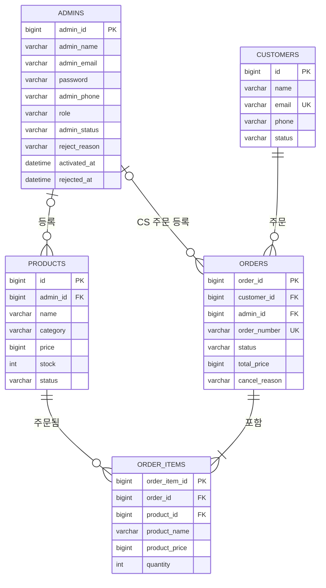

[← README로 돌아가기](../README.md)

# 🗂 테이블 명세서

## 📌 목차

1. [ERD](#erd)
2. [테이블 목록](#테이블-목록)
3. [공통 컬럼](#공통-컬럼)
4. [테이블 상세](#테이블-상세)
    - [admins](#admins--관리자) · [customers](#customers--고객) · [products](#products--상품) · [orders](#orders--주문) · [order_items](#order_items--주문-상품)
5. [연관관계](#연관관계)

 

## ERD

 

## 테이블 목록

| 테이블 | 엔티티 | 설명 | 삭제 방식 |
| --- | --- | --- | --- |
| `admins` | `Admin` | 백오피스 관리자 계정 | 논리 삭제 (`@SQLRestriction`으로 조회 시 자동 제외) |
| `customers` | `Customer` | 이커머스 고객 | 논리 삭제 |
| `products` | `Product` | 판매 상품 | 논리 삭제 |
| `orders` | `Order` | 주문 | 삭제 기능 없음 (취소는 상태 변경) |
| `order_items` | `OrderItem` | 주문에 포함된 상품 | 삭제 기능 없음 |

 

## 공통 컬럼

`admins`, `customers`, `orders`는 `BaseEntity`를 상속하고, `products`는 같은 컬럼을 직접 가지고 있습니다.
`created_at`, `updated_at`은 JPA Auditing으로 자동 기록됩니다.

| 컬럼 | 타입 | 제약 조건 | 설명 |
| --- | --- | --- | --- |
| `created_at` | DATETIME | NOT NULL | 생성 일시 (수정 불가) |
| `updated_at` | DATETIME | NOT NULL | 마지막 수정 일시 |
| `deleted_at` | DATETIME | NULL | 삭제 일시 (값이 있으면 삭제된 데이터) |

> `order_items`에는 공통 컬럼이 없습니다.

 

## 테이블 상세

### admins — 관리자

| 컬럼 | 타입 | 제약 조건 | 설명 |
| --- | --- | --- | --- |
| `admin_id` | BIGINT | PK, AUTO_INCREMENT | 관리자 ID |
| `admin_name` | VARCHAR(20) | NOT NULL | 이름 |
| `admin_email` | VARCHAR(20) | NOT NULL | 이메일 (중복 검사는 서비스에서 처리) |
| `password` | VARCHAR(255) | NOT NULL | BCrypt로 암호화한 비밀번호 |
| `admin_phone` | VARCHAR(20) | NOT NULL | 전화번호 (`010-XXXX-XXXX`) |
| `role` | VARCHAR(30) | NOT NULL | 역할 |
| `admin_status` | VARCHAR(20) | NOT NULL | 계정 상태 (가입 시 `PENDING`) |
| `reject_reason` | VARCHAR(200) | NULL | 거부 사유 |
| `activated_at` | DATETIME | NULL | 승인 일시 |
| `rejected_at` | DATETIME | NULL | 거부 일시 |
| `created_at` | DATETIME | NOT NULL | 가입일 |
| `updated_at` | DATETIME | NOT NULL | 수정일 |
| `deleted_at` | DATETIME | NULL | 삭제일 |

상태값

**`role`**

| 값 | 설명 |
| --- | --- |
| `SUPER_ADMIN` | 슈퍼 관리자 |
| `OPERATION_ADMIN` | 운영 관리자 |
| `CS_ADMIN` | CS 관리자 |

**`admin_status`**

| 값 | 설명 |
| --- | --- |
| `PENDING` | 승인 대기 |
| `ACTIVATE` | 활성 (로그인 가능) |
| `DEACTIVATE` | 비활성 |
| `SUSPENDED` | 정지 |
| `REJECTED` | 거부 |

 

### customers — 고객

| 컬럼 | 타입 | 제약 조건 | 설명 |
| --- | --- | --- | --- |
| `id` | BIGINT | PK, AUTO_INCREMENT | 고객 ID |
| `name` | VARCHAR(100) | NOT NULL | 이름 |
| `email` | VARCHAR(255) | NOT NULL, UNIQUE | 이메일 |
| `phone` | VARCHAR(15) | NULL | 전화번호 |
| `status` | VARCHAR(15) | NOT NULL | 고객 상태 |
| `created_at` | DATETIME | NOT NULL | 가입일 |
| `updated_at` | DATETIME | NOT NULL | 수정일 |
| `deleted_at` | DATETIME | NULL | 삭제일 |

상태값

**`status`**

| 값 | 설명 |
| --- | --- |
| `ACTIVE` | 활성 |
| `INACTIVE` | 비활성 |
| `SUSPENDED` | 정지 |

 

### products — 상품

| 컬럼 | 타입 | 제약 조건 | 설명 |
| --- | --- | --- | --- |
| `id` | BIGINT | PK, AUTO_INCREMENT | 상품 ID |
| `admin_id` | BIGINT | FK → `admins.admin_id`, NULL | 등록 관리자 |
| `name` | VARCHAR(100) | NOT NULL | 상품명 |
| `category` | VARCHAR(15) | NOT NULL | 카테고리 |
| `price` | BIGINT | NOT NULL | 가격 (0 이상) |
| `stock` | INT | NOT NULL | 재고 (0 이상) |
| `status` | VARCHAR(15) | NOT NULL | 판매 상태 |
| `created_at` | DATETIME | NOT NULL | 등록일 |
| `updated_at` | DATETIME | NOT NULL | 수정일 |
| `deleted_at` | DATETIME | NULL | 삭제일 |

상태값

**`status`**

| 값 | 설명 | 전환 규칙 |
| --- | --- | --- |
| `ON_SALE` | 판매중 | 재고 1 이상이면 자동 전환 |
| `OUT_OF_STOCK` | 품절 | 재고 0이면 자동 전환 |
| `DISCONTINUED` | 단종 | 직접 설정 · 해제, 재고가 바뀌어도 유지 |

 

### orders — 주문

| 컬럼 | 타입 | 제약 조건 | 설명 |
| --- | --- | --- | --- |
| `order_id` | BIGINT | PK, AUTO_INCREMENT | 주문 ID |
| `customer_id` | BIGINT | FK → `customers.id`, NOT NULL | 주문 고객 |
| `admin_id` | BIGINT | FK → `admins.admin_id`, NULL | 등록 관리자 (CS 주문일 때만 저장) |
| `order_number` | VARCHAR(50) | NOT NULL, UNIQUE | 주문번호 (`yyyyMMdd-NNN`) |
| `status` | VARCHAR(20) | NOT NULL | 주문 상태 (생성 시 `PREPARING`) |
| `total_price` | BIGINT | NOT NULL | 총 금액 (주문 시점 단가 × 수량의 합) |
| `cancel_reason` | VARCHAR(255) | NULL | 취소 사유 |
| `created_at` | DATETIME | NOT NULL | 주문일 |
| `updated_at` | DATETIME | NOT NULL | 수정일 |
| `deleted_at` | DATETIME | NULL | 삭제일 |

상태값

**`status`** — `PREPARING` → `SHIPPING` → `DELIVERED` 순서로만 변경, 취소는 `PREPARING`에서만 가능

| 값 | 설명 |
| --- | --- |
| `PREPARING` | 준비중 |
| `SHIPPING` | 배송중 |
| `DELIVERED` | 배송완료 |
| `CANCELLED` | 취소됨 |

 

### order_items — 주문 상품

| 컬럼 | 타입 | 제약 조건 | 설명 |
| --- | --- | --- | --- |
| `order_item_id` | BIGINT | PK, AUTO_INCREMENT | 주문 상품 ID |
| `order_id` | BIGINT | FK → `orders.order_id`, NOT NULL | 주문 |
| `product_id` | BIGINT | FK → `products.id`, NOT NULL | 상품 |
| `product_name` | VARCHAR(100) | NOT NULL | 주문 시점 상품명 |
| `product_price` | BIGINT | NOT NULL | 주문 시점 단가 |
| `quantity` | INT | NOT NULL | 수량 |

> 상품명과 단가를 주문 시점 값으로 따로 저장해, 이후 상품 정보가 바뀌거나 삭제되어도 주문 내역이 그대로 유지됩니다.

 

## 연관관계

모든 연관관계는 **단방향 `@ManyToOne(fetch = LAZY)`** 으로 매핑했습니다.

| 엔티티 (N) | 필드 | 대상 (1) | FK 컬럼 | 필수 |
| --- | --- | --- | --- | :---: |
| `Product` | `admin` | `Admin` | `products.admin_id` | ❌ |
| `Order` | `customer` | `Customer` | `orders.customer_id` | ✅ |
| `Order` | `registerAdmin` | `Admin` | `orders.admin_id` | ❌ |
| `OrderItem` | `order` | `Order` | `order_items.order_id` | ✅ |
| `OrderItem` | `product` | `Product` | `order_items.product_id` | ✅ |